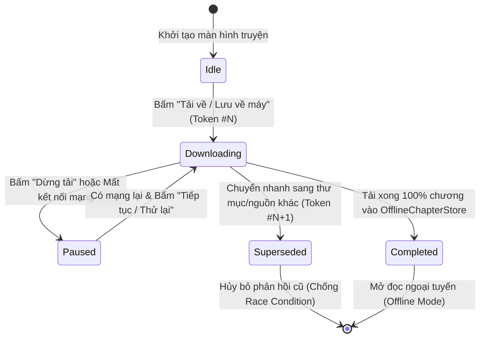

# ĐẶC TẢ THIẾT KẾ CA KIỂM THỬ (TEST DESIGN SPECIFICATION)

Tài liệu này trình bày chi tiết việc áp dụng các kỹ thuật thiết kế kiểm thử **Hộp đen (Black-box)** và **Hộp trắng (White-box)** cho ứng dụng **vBook Reader**.

---

## 1. Phân vùng tương đương (EP) & Phân tích giá trị biên (BVA)

| Chức năng / Biến đầu vào | Phân vùng tương đương (Equivalence Partitions) | Giá trị biên kiểm thử (Boundary Values) | Mã TC / Tệp Test |
| :--- | :--- | :--- | :--- |
| **Mật khẩu đăng ký (`UC-U1`)** | - `EP1` (Không hợp lệ): Rỗng (`0` ký tự) - `EP2` (Không hợp lệ): `1..5` ký tự - `EP3` (Hợp lệ): `>= 6` ký tự | `0` ký tự (Fail), `5` ký tự (Fail), `6` ký tự (Pass), `7` ký tự (Pass) | `TC_FUNC_01`, `TC_FUNC_03`, `auth_security_test.dart` |
| **Tên hiển thị hồ sơ (`UC-C2`)** | - `EP1` (Không hợp lệ): Rỗng (`0` ký tự) - `EP2` (Hợp lệ): `1..30` ký tự - `EP3` (Không hợp lệ): `> 30` ký tự | `0` (Fail), `1` (Pass), `30` (Pass), `31` (Fail) | `TC_FUNC_06`, `profile_screen_test.dart` |
| **Khóa API Gemini (Ellie AI)** | - `EP1` (Không hợp lệ): Chuỗi rỗng hoặc ngắn - `EP2` (Hợp lệ chuẩn cũ): Bắt đầu bằng `AIzaSy`, dài `39` ký tự - `EP3` (Hợp lệ chuẩn mới): Bắt đầu bằng `AQ.`, dài `>= 30` ký tự - `EP4` (Không hợp lệ): Tiền tố lạ | Độ dài `0`, `11` (Fail); `39` ký tự với `AIzaSy` (Pass); tiền tố `AQ.` hợp lệ (Pass) | `TC_SEC_13`, `translator_bot_api_key_test.dart` |
| **Giới hạn giải nén Plugin ZIP** | - `EP1` (Hợp lệ): Tổng dung lượng `<= 64MB` và tỷ lệ nén `<= 100x` - `EP2` (Zip Bomb): Dung lượng `> 64MB` hoặc tỷ lệ nén `> 100x` | `64MB` (Pass), `64MB + 1B` (Chặn); Tỷ lệ nén `100x` (Pass), `101x` (Chặn) | `TC_SEC_08`, `plugin_loader_security_test.dart` |

---

## 2. Kỹ thuật Bảng quyết định (Decision Table Testing) – Phân quyền Firestore RBAC

| Điều kiện (Conditions) / Hành động (Actions) | Quy tắc R1 (Khách) | Quy tắc R2 (Chưa verify email) | Quy tắc R3 (Truy cập chéo) | Quy tắc R4 (User hợp lệ) | Quy tắc R5 (Admin Claim) |
| :--- | :-: | :-: | :-: | :-: | :-: |
| **C1:** Đã đăng nhập (`request.auth != null`) | `False` | `True` | `True` | `True` | `True` |
| **C2:** Đúng chủ sở hữu (`auth.uid == userId`) | `-` | `True` | `False` | `True` | `True` |
| **C3:** Đã xác minh Email (`email_verified == true`) | `-` | `False` | `True` | `True` | `True` |
| **C4:** Có Custom Claim Admin (`token.admin == true`) | `-` | `False` | `False` | `False` | `True` |
| **A1:** Đọc/Ghi kệ sách cá nhân (`/users/{userId}`) | Từ chối (`403`) | Cho phép | Từ chối (`403`) | Cho phép | Cho phép |
| **A2:** Gửi bình luận cộng đồng (`/community`) | Từ chối (`403`) | Từ chối (`403`) | Cho phép | Cho phép | Cho phép |
| **A3:** Tự sửa trường `role = 'admin'` | Từ chối (`403`) | Từ chối (`403`) | Từ chối (`403`) | Từ chối (`403`) | Từ chối (Server-only) |
| **A4:** Quản trị nguồn Drive & Xóa tin vi phạm | Từ chối (`403`) | Từ chối (`403`) | Từ chối (`403`) | Từ chối (`403`) | Cho phép |
| **Mã Test Case đối chiếu** | `TC_FUNC_05` | `TC_SEC_04` | `TC_SEC_03` | `TC_FUNC_25` | `TC_SEC_05`, `TC_SEC_06` |

---

## 3. Kỹ thuật Kiểm thử chuyển trạng thái (State Transition Testing)

---

## 4. Kỹ thuật Kiểm thử Hộp trắng (White-box Testing)

### 4.1. Phân tích Đồ thị dòng điều khiển (CFG) hàm `validatePluginId(String id)`
- **Các nút quyết định (Predicate Nodes):**
  1. `N1`: `if (id.trim().isEmpty)` → Từ chối chuỗi rỗng.
  2. `N2`: `if (id.length > 64)` → Từ chối ID vượt quá 64 ký tự.
  3. `N3`: `if (id.contains('..') || id.contains('/') || id.contains('\'))` → Chặn Path Traversal.
  4. `N4`: `if (!RegExp(r'^[a-zA-Z0-9._-]+$').hasMatch(id))` → Chặn ký tự đặc biệt/tiêm lệnh.
  5. `N5`: Kiểm tra tiền tố/hậu tố dấu chấm không hợp lệ.
- **Độ phức tạp chu trình (Cyclomatic Complexity):**
  $$V(G) = P + 1 = 5 + 1 = 6$$
- **Các đường đi cơ sở độc lập (Basis Paths):**

| Đường cơ sở | Đầu vào kiểm thử (Test Input) | Kết quả kỳ vọng | Tệp Unit Test |
| :--- | :--- | :--- | :--- |
| **Path 1** | `'vbook.ext.hako_v1'` | Hợp lệ (`true`) | `test/plugin_loader_security_test.dart` |
| **Path 2** | `''` hoặc `'   '` | Không hợp lệ (`false` – rỗng) | `test/plugin_loader_security_test.dart` |
| **Path 3** | `'a' * 65` | Không hợp lệ (`false` – quá 64 ký tự) | `test/plugin_loader_security_test.dart` |
| **Path 4** | `'../../etc/passwd'` | Không hợp lệ (`false` – Path Traversal) | `test/plugin_loader_security_test.dart` |
| **Path 5** | `'plugin$evil;rm'` | Không hợp lệ (`false` – sai Regex) | `test/plugin_loader_security_test.dart` |
| **Path 6** | `'.hidden_plugin'` | Không hợp lệ (`false` – bắt đầu bằng dấu chấm) | `test/plugin_loader_security_test.dart` |

### 4.2. Kiểm thử Hộp trắng Bộ phân tích Manga cục bộ (`LocalMangaParser`)
- Đạt **100% Branch Coverage** trên tệp [`test/local_manga_parser_test.dart`](../test/local_manga_parser_test.dart):
  1. Nhánh phân tích tệp chỉ mục `chapter.json` có cấu trúc danh sách (`JSON List`).
  2. Nhánh phân tích tệp chỉ mục `chapter.json` có cấu trúc ánh xạ (`JSON Map`).
  3. Nhánh tự động quét các thư mục con và sắp xếp thứ tự tự nhiên (*Natural Sort*: `Chương 1`, `Chương 2`, ..., `Chương 10`).
  4. Nhánh xử lý an toàn khi thư mục rỗng hoặc tệp JSON hỏng.
